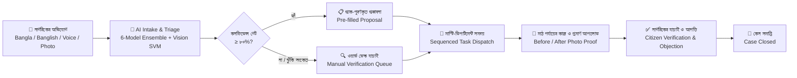

# 🏙️ নাগরিক সাথী — Nagorik Sathi
### *AI-Powered Civic Service & Multi-Department Incident Resolution Platform*

<div align="center">


[](https://fastapi.tiangolo.com/)
[](https://react.dev/)
[](https://www.typescriptlang.org/)
[](https://tailwindcss.com/)
[](https://scikit-learn.org/)
[](https://www.docker.com/)
[](https://www.open311.org/)
[](#-bilingual-ui)

**নাগরিক অভিযোগ থেকে সমন্বিত সমাধান — স্বচ্ছ, প্রমাণ-ভিত্তিক ও দায়বদ্ধ নগর সেবা**  
*From Citizen Report to Coordinated Resolution — Transparent, Evidence-Backed & Accountable Civic Governance*

[✨ মূল সুবিধাসমূহ](#-key-capabilities) • [🎯 ৭টি নাগরিক সমস্যা](#-the-7-civic-problem-domains) • [🧠 AI ও ML মডেলসমূহ](#-aiml-architecture--models) • [👥 সিস্টেমের রোলসমূহ](#-user-roles--rbac) • [🚀 দ্রুত শুরু](#-getting-started) • [🔑 ডেমো অ্যাকাউন্ট](#-demo-accounts)

</div>

---

## 📖 সারসংক্ষেপ (Executive Summary)

**নাগরিক সাথী (Nagorik Sathi)** হলো একটি আধুনিক, কৃত্রিম বুদ্ধিমত্তা-সমর্থিত (AI-assisted) নাগরিক সেবা ও সিটি কর্পোরেশন সমন্বয় প্ল্যাটফর্ম। এটি নাগরিক সমস্যা শনাক্তকরণ থেকে শুরু করে সংশ্লিষ্ট দপ্তরে কাজের দায়িত্ব বণ্টন, মাঠপর্যায়ে কাজ সম্পাদন, আলোকচিত্রের মাধ্যমে প্রমাণ যাচাই এবং নাগরিকের সন্তুষ্টির ভিত্তিতে কেস নিষ্পত্তি নিশ্চিত করে।

> ### 💡 মূল নীতি (Core Philosophy): **"AI proposes, people decide"**
> কৃত্রিম বুদ্ধিমত্তা কখনোই স্বয়ংক্রিয়ভাবে কোনো কেস বন্ধ করতে পারবে না এবং নাগরিক সন্তুষ্ট হয়েছেন বলে দাবি করতে পারবে না। AI কেবল প্রস্তাব করবে, সিদ্ধান্ত নেবেন দায়িত্বপ্রাপ্ত কর্মকর্তা এবং চূড়ান্ত যাচাই করবেন নাগরিক নিজে।



---

## 🎯 যে ৭টি নাগরিক সমস্যা নিয়ে কাজ করছে (The 7 Civic Problem Domains)

নগর জীবনে নাগরিকরা যে প্রধান ৭টি সমস্যার মুখোমুখি হন, সেগুলোকে চিহ্নিত করে প্রতিটি সমস্যার জন্য দায়িত্বপ্রাপ্ত বিভাগ, প্রবিধান (Responsibility Rules) ও স্বয়ংক্রিয় এসএলএ (SLA) নির্ধারণ করা হয়েছে:

| আইকন | সমস্যা ক্ষেত্র (Problem Domain) | দায়িত্বপ্রাপ্ত বিভাগ (Responsible Wing) | যেসব অভিযোগ সমাধান করা হয় (Specific Issues Handled) | ডিফল্ট SLA |
| :---: | :--- | :--- | :--- | :---: |
| 💧 | **পানি সরবরাহ ও পাইপলাইন**<br>*(Water Supply & Quality)* | **পানি সরবরাহ ও ওয়াসা উইং (WASA Wing)** | • পাইপলাইন লিকেজ বা ফেটে রাস্তায় পানি উপচে পড়া<br>• পানির তীব্র সংকট বা সম্পূর্ণ সরবরাহ বন্ধ<br>• নোংরা, দুর্গন্ধযুক্ত বা অনিরাপদ পানি সরবরাহ<br>• লাইনে পানির অস্বাভাবিক কম চাপ | **১২–২৪ ঘণ্টা** |
| 🛣️ | **সড়ক পরিবহন ও অবকাঠামো**<br>*(Road Transport & Infrastructure)* | **সড়ক ও অবকাঠামো প্রকৌশল বিভাগ (Roads Dept)** | • বিপজ্জনক খানাখন্দ ও ভাঙা পিচঢালাই (Potholes)<br>• অবৈধ দখল বা ক্ষতিগ্রস্ত ফুটপাত<br>• ফুটওভারব্রিজ ও সড়ক বিভাজকের ক্ষতি<br>• যানবাহন চলাচলে বাধা সৃষ্টিকারী রাস্তা | **২৪–৭২ ঘণ্টা** |
| 🗑️ | **বর্জ্য ব্যবস্থাপনা**<br>*(Waste Management)* | **বর্জ্য ব্যবস্থাপনা বিভাগ (Waste Dept)** | • সড়কে ও আবাসিক এলাকায় আবর্জনার স্তূপ<br>• উপচে পড়া ডাস্টবিন ও সেকেন্ডারি স্টেশন (STS)<br>• ড্রেন বা উন্মুক্ত স্থানে প্লাস্টিক বর্জ্য ফেলা<br>• সময়মতো বর্জ্য অপসারণে ব্যর্থতা | **৬–২৪ ঘণ্টা** |
| ⚡ | **বিদ্যুৎ ও সড়কবাতি**<br>*(Electricity & Lighting)* | **বিদ্যুৎ ও সড়কবাতি বিভাগ (Lighting Dept)** | • অচল বা নিভে থাকা সড়কবাতি (Dark Spots)<br>• বিপজ্জনকভাবে ঝুলন্ত ও ছেঁড়া বৈদ্যুতিক তার<br>• শর্টসার্কিট ঝুঁকি ও ক্ষতিগ্রস্ত বিদ্যুতের খুঁটি<br>• ট্রান্সফরমার ও ফিডার সংক্রান্ত জটিলতা | **২–১২ ঘণ্টা**<br>*(ঝুঁকি সাপেক্ষে)* |
| 🏥 | **জনস্বাস্থ্য ও রোগ নিয়ন্ত্রণ**<br>*(Public Health & Sanitation)* | **জনস্বাস্থ্য ও রোগ নিয়ন্ত্রণ বিভাগ (Health Dept)** | • এডিস মশার প্রজননস্থল ও ডেঙ্গু হটস্পট<br>• ড্রেনে বা উন্মুক্ত জলাশয়ে ক্ষতিকর লার্ভা<br>• নগর স্বাস্থ্যকেন্দ্র ও ক্লিনিকের স্যানিটেশন<br>• সংক্রামক ব্যাধি ও মহামারী প্রতিরোধ ব্যবস্থা | **১২–২৪ ঘণ্টা** |
| 🍲 | **খাদ্য নিরাপত্তা ও ভোক্তা অধিকার**<br>*(Food Safety & Quality)* | **খাদ্য নিরাপত্তা শাখা (Food Safety Unit)** | • রেস্তোরাঁ ও হোটেলে বাসি-পচা খাদ্য বিক্রি<br>• খাদ্যদ্রব্যে ক্ষতিকর রাসায়নিক বা ভেজাল মিশ্রণ<br>• মেয়াদোত্তীর্ণ শিশুখাদ্য ও নিত্যপ্রয়োজনীয় পণ্য<br>• অস্বাস্থ্যকর পরিবেশে খাদ্য প্রস্তুত ও পরিবেশন | **২৪–৪৮ ঘণ্টা** |
| 🌊 | **ড্রেনেজ ও নর্দমা প্রকৌশল**<br>*(Drainage & Sewerage)* | **ড্রেনেজ ও নর্দমা বিভাগ (Drainage Dept)** | • নর্দমায় পলি বা বর্জ্য জমে পানি নিষ্কাশন বন্ধ<br>• খোলা বা ভাঙা ম্যানহোল ও স্ল্যাব (মৃত্যুঝুঁকি)<br>• সামান্য বৃষ্টিতেই দীর্ঘস্থায়ী জলাবদ্ধতা<br>• উপচে পড়া স্যুয়ারেজ লাইন ও বিষাক্ত বর্জ্য | **২–১২ ঘণ্টা**<br>*(জরুরি)* |

### 🔀 সমন্বিত বহুমাত্রিক সমস্যা (Compound Multi-Department Problems)
বাস্তবে অধিকাংশ নাগরিক সমস্যা একক কোনো বিভাগের অধীনে থাকে না। **নাগরিক সাথী প্ল্যাটফর্ম স্বয়ংক্রিয়ভাবে জটিল সমস্যাকে ক্রমানুসারে বিভক্ত করে:**
> **উদাহরণ:** *"ড্রেনে বর্জ্য জমে পানি উপচে রাস্তা ভেঙে গেছে এবং পাশের সড়কবাতি অচল।"*  
> 1. **ধাপ ১ (বর্জ্য বিভাগ):** ড্রেনের মুখের বর্জ্য অপসারণ করবে।  
> 2. **ধাপ ২ (ড্রেনেজ বিভাগ):** নর্দমার গভীর পলি নিষ্কাশন করবে এবং স্ল্যাব মেরামত করবে।  
> 3. **ধাপ ৩ (সড়ক বিভাগ):** ড্রেন পরিষ্কারের পর শুকনো রাস্তায় পিচঢালাই সম্পন্ন করবে।  
> 4. **ধাপ ৪ (বিদ্যুৎ বিভাগ):** সড়কবাতির তার ঠিক করবে।  
> *এক বিভাগের কাজ শেষ না হওয়া পর্যন্ত পরবর্তী বিভাগ কাজ শুরু করতে পারবে না (Prerequisite Task Sequencing)।*

---

## 🧠 AI ও ML মডেলসমূহ (AI/ML Architecture & Models)

নাগরিক সাথীতে ব্যবহার করা হয়েছে বহুভাষিক টেক্সট ক্লাসিফিকেশন এনসেম্বল, কম্পিউটার ভিশন এডভাইজরি মডেল এবং রুল-বেজড ডিসিশন পাইপলাইন।

```
                                 [নাগরিকের ইনপুট]
                                  /             \
                  [বাংলা/বাংলিশ টেক্সট]        [ছবি/আলোকচিত্র]
                          |                           |
                 Unicode Normalizer           Compact 128x128 HOG
                 Phonetic Replacements       + Spatial Color Hist
                          |                           |
            ┌─────────────┴─────────────┐             |
            │   6-Model Text Ensemble   │             |
            │ 1. Word Logistic Reg      │             |
            │ 2. Calibrated Char SVM    │             |
            │ 3. Word Multinomial NB    │             v
            │ 4. Char Complement NB     │       [HOG + RBF SVM]
            │ 5. Hybrid SGD Log-Loss    │     Vision Classifier
            │ 6. SVD + Random Forest    │             |
            └─────────────┬─────────────┘             |
                          \                          /
                           \                        /
                        [সমন্বিত কনফিডেন্স স্কোর]
                                    |
                    ┌───────────────┴───────────────┐
                    │ 80% AI Routing Confidence Gate│
                    └───────────────┬───────────────┘
                                    |
                    [Deterministic PostGIS & Rules]
                                    |
                    [Emergency Hazard Detection S9]
```

### ১. সিক্স-মডেল টেক্সট এনসেম্বল (6-Model Text Ensemble)
বাংলা, বাংলিশ ও ইংরেজি টেক্সট থেকে সঠিক ক্যাটাগরি ও অগ্রাধিকার নির্ধারণের জন্য ৬টি ভিন্ন অ্যালগরিদমের একটি শক্তিশালী এনসেম্বল কাজ করে (`backend/ml/nagarai_ml/ensemble.py`):

1. **Word Logistic Regression**: TF-IDF শব্দভিত্তিক n-grams (1–2) এবং L2 রেগুলারাইজেশন সহ লজিস্টিক রিগ্রেশন।
2. **Calibrated Character Linear SVM**: TF-IDF অক্ষরভিত্তিক n-grams (2–5) এবং `CalibratedClassifierCV` দ্বারা প্ল্যাট স্কেলিং করে নিখুঁত সম্ভাব্যতা নির্ণয়।
3. **Word Multinomial Naive Bayes**: দ্রুত শব্দ-সম্ভাব্যতা গণনায় কার্যকর ন্যাইভ বেইস।
4. **Character Complement Naive Bayes**: অসম ভারসাম্যযুক্ত (imbalanced) ডেটাসেট ও ক্ষুদ্র বাংলিশ বাক্যের জন্য বিশেষভাবে উপযুক্ত।
5. **Hybrid SGD Log-Loss Classifier**: `FeatureUnion` দিয়ে শব্দ ও অক্ষরের ভেক্টরাইজার একত্রিত করে স্টোকাস্টিক গ্রেডিয়েন্ট ডিসেন্ট।
6. **SVD + Random Forest Classifier**: `TruncatedSVD` ডাইমেনশনালিটি রিডাকশন ও ডিসিশন ট্রির সমন্বিত নন-লিনিয়ার ক্লাসিফায়ার।

* **ডেটা বৈশিষ্ট্য:** ৮৩৯টি যাচাইকৃত সিন্থেটিক ট্রেইনিং স্যাম্পল, ৭টি ক্যাটাগরি, ৩ স্তরের তীব্রতা (Low/Medium/High) এবং ট্রেইন/ভ্যালিডেশন লিকেজ রোধক স্প্লিট।
* **বাংলা টেক্সট নরমালাইজার:** ইউনিকোড NFC নরমালাইজেশন এবং বাংলা-বাংলিশ দ্ব্যর্থবোধক ফ্রেজ ম্যাপিং (যেমন: *'rastay gorto'* $\rightarrow$ *pothole*, *'pani nai'* $\rightarrow$ *water outage*, *'khola manhole'* $\rightarrow$ *open manhole*)।

### ২. কম্পিউটার ভিশন এডভাইজরি মডেল (Vision HOG + RBF SVM)
নাগরিকের আপলোড করা ছবির সত্যতা ও প্রাথমিক ক্যাটাগরি যাচাইয়ের জন্য একটি হালকা ও দ্রুত কম্পিউটার ভিশন পাইপলাইন সংযুক্ত রয়েছে (`backend/ml/vision_features.py`):
* **ফিচার নিষ্কাশন (Feature Extraction):** 
  - $128 \times 128$ পিক্সেল সাইজে রূপান্তর।
  - **HOG (Histogram of Oriented Gradients):** $8 \times 8$ সেল সাইজ এবং ৯টি অরিয়েন্টেশন বিনে গ্র্যাডিয়েন্ট গণনা।
  - **Spatial Color Histogram:** $4 \times 4$ গ্রিডে প্রতি কালার চ্যানেলে (RGB) রঙের বিস্তার পরিমাপ।
* **মডেল:** Radial Basis Function (RBF) কার্নেল ভিত্তিক Support Vector Machine (SVM)।
* **ভূমিকা:** এটি শুধুমাত্র প্রাথমিক পরামর্শক (Advisory); দায়িত্বশীল কর্মকর্তা ছাড়া কোনো ছবি স্বয়ংক্রিয়ভাবে ফাইনাল সিদ্ধান্ত হিসেবে গৃহীত হয় না।

### ৩. রাউটিং কনফিডেন্স গেট (80% Routing Confidence Gate)
AI মডেল থেকে প্রাপ্ত ফলাফল সরাসরি সিস্টেমে গৃহীত হয় না। এটি একটি গাণিতিক গেটের মাধ্যমে যাচাই করা হয়:
$$\text{Overall Confidence} = (0.40 \times C_{\text{class}}) + (0.35 \times C_{\text{location}}) + (0.25 \times C_{\text{rule}})$$
* **শর্ত ১:** কনফিডেন্স স্কোর $\ge ৮০\%$ হতে হবে।
* **শর্ত ২:** কোনো জরুরি ঝুঁকি সংকেত (Critical Hazard Flag) থাকা চলবে না।
* শর্ত পূরণ হলে প্রাক-পূরণকৃত প্রস্তাবনা তৈরি হয়; অন্যথায় স্বয়ংক্রিয়ভাবে ওয়ার্ড ডেস্কের ম্যানুয়াল ভেরিফিকেশন কিউতে চলে যায়।

### ৪. জরুরি প্রায়োরিটি ট্রায়াজ ও সেফটি রুল (Safety Rule S9)
* খোলা ম্যানহোল, ঝুলন্ত বৈদ্যুতিক তার, হাসপাতালের প্রবেশপথে জলাবদ্ধতার মতো বিষয়গুলোকে স্বয়ংক্রিয়ভাবে **EMERGENCY** ফ্ল্যাগ প্রদান করে।
* **স্টাফ সুরক্ষা নীতি:** AI কখনোই কোনো মানব কর্মকর্তার নির্ধারিত অগ্রাধিকার হ্রাস করতে পারে না।

### ৫. ডুপ্লিকেট শনাক্তকরণ ও হটস্পট বিশ্লেষণ (Deduplication & Hotspots)
* **Spatial Matching:** GPS স্থানাঙ্ক (নির্দিষ্ট ব্যাসার্ধ, যেমন: ১০০ মিটার)।
* **Temporal Window:** ৭২ ঘণ্টার টাইম উইন্ডো।
* **Semantic Similarity:** টেক্সট এমবেডিংস কোসাইন সিমিলারিটি।
* একই স্থানে বারবার পুনরাবৃত্ত সমস্যা শনাক্ত করে প্রকৌশলীদের জন্য টেকসই সমাধানের গাইডলাইন প্রস্তাব করে।

### ৬. গ্রাউন্ডেড সার্ভিস নলেজ RAG (Retrieval-Augmented Generation)
* সিটি কর্পোরেশনের নাগরিক সেবা সনদ (Citizen Charter) ও সরকারি গেজেট থেকে সরাসরি উত্তর প্রদান।
* **জিরো হ্যালুসিনেশন গ্যারান্টি:** মডেল মেমোরি থেকে কোনো সরকারি ফি বা আইনগত শর্ত বানিয়ে বলা সম্পূর্ণ নিষিদ্ধ; সংরক্ষিত ডকুমেন্টে তথ্য না থাকলে সরাসরি কর্মকর্তাকে রেফার করে।

---

## 🛠️ নাগরিক সাথী প্ল্যাটফর্মের সেবাসমূহ (Services Provided)

| সেবা (Service) | বিবরণ (Description) | ব্যবহারকারী (Beneficiary) |
| :--- | :--- | :--- |
| **বহুভাষিক অভিযোগ দাখিল** | বাংলা টেক্সট, ভয়েস রেকর্ডিং (Bangla Voice ASR) অথবা ছবির মাধ্যমে সরাসরি অভিযোগ পাঠানো। | নাগরিক |
| **লাইভ স্ট্যাটাস ও ট্র্যাকিং** | অভিযোগ দাখিলের পর ৮টি নির্ধারিত ধাপে অগ্রগতি পর্যবেক্ষণ (WebSocket/SSE নোটিফিকেশন)। | নাগরিক |
| **লাইভ সিভিক ম্যাপ** | ওয়ার্ডভিত্তিক সমস্যার লাইভ পিন ম্যাপ (নাগরিকের ব্যক্তিগত পরিচয় গোপন রেখে কেবল ঘটনার অবস্থান)। | নাগরিক ও সাধারণ জনগণ |
| **দায়িত্বপ্রাপ্ত কর্মকর্তার পরিচয়** | নিজের কেসে কোন ওয়ার্ডের কোন প্রকৌশলী কাজ করছেন তার অফিশিয়াল নাম ও ফোন নম্বর প্রাপ্তি। | নাগরিক |
| **সমাধানের প্রমাণ ও আপত্তি** | কাজ শেষ হওয়ার পর ফিল্ড অফিসারের আপলোডকৃত 'আগের ও পরের' ছবি দেখে সন্তুষ্টি যাচাই বা আপত্তি জানানোর অধিকার। | নাগরিক |
| **আস্ক সাথী (নাগরিক সেবা সনদ)** | ট্রেড লাইসেন্স, হোল্ডিং ট্যাক্স, জন্মনিবন্ধন ফি ও নিয়মাবলি তাৎক্ষণিক জেনে নেওয়ার AI সহায়তা। | নাগরিক |
| **ওয়ার্ড সেবা ডেস্ক সহায়তা** | নিরক্ষর বা বয়োবৃদ্ধ নাগরিকদের পক্ষে ওয়ার্ড সেন্টারের কর্মকর্তাদের মাধ্যমে অভিযোগ এন্ট্রি ও পরিচালনা। | নাগরিক ও ওয়ার্ড স্টাফ |
| **স্বয়ংক্রিয় এসএলএ এস্কেলেশন** | নির্দিষ্ট সময়ের মধ্যে কাজ সম্পন্ন না হলে উচ্চপদস্থ কর্মকর্তা ও মেয়রের ড্যাশবোর্ডে স্বয়ংক্রিয় সতর্কবার্তা। | সমন্বয়ক ও প্রশাসন |
| **পাবলিক ট্রান্সপারেন্সি পোর্টাল** | ওয়ার্ড অনুযায়ী অভিযোগ নিষ্পত্তি হার, গড় সময় ও পারফরম্যান্স লিডারবোর্ড (Open311 কমপ্লায়েন্ট)। | গবেষক, সাংবাদিক ও জনগণ |

---

## 👥 সিস্টেমের রোলসমূহ ও দায়িত্ব (User Roles & RBAC Matrix)

সিস্টেমে মোট **৭টি সুনির্দিষ্ট ভূমিকা** রয়েছে, যাতে নিরাপত্তা ও দায়িত্বের কোনো বিরোধ না ঘটে:

```
┌────────────────────────────────────────────────────────────────────────┐
│                      CITY GOVERNANCE HEAD (পলিসি প্রধান)                 │
│         [পলিসি অনুমোদন]  [AI গেট হ্রাস অনুমোদন]  [SLA পলিসি নিয়ন্ত্রণ]   │
└───────────────────────────────────┬────────────────────────────────────┘
                                    │
┌───────────────────────────────────┴────────────────────────────────────┐
│                    CENTRAL CASE COORDINATOR (প্রধান সমন্বয়ক)           │
│        [মাল্টি-ডিপার্টমেন্ট টাস্ক চেইনিং]  [এস্কেলেশন হ্যান্ডলিং]  [কেস সমাপ্তি]   │
└─────────────┬────────────────────────────────────────────┬─────────────┘
              │                                            │
┌─────────────┴──────────────┐              ┌──────────────┴─────────────┐
│  WARD DESK OFFICER         │              │  FIELD / DEPT OFFICER      │
│  [ওয়ার্ড ভেরিফিকেশন]      │              │  [ফিল্ড টাস্ক এক্সিকিউশন]   │
│  [ডুপ্লিকেট মার্জ]         │              │  [প্রমাণ ছবি আপলোড]        │
└─────────────┬──────────────┘              └──────────────┬─────────────┘
              │                                            │
┌─────────────┴──────────────┐              ┌──────────────┴─────────────┐
│  CITIZEN (নাগরিক)          │              │  SYSTEM ADMINISTRATOR      │
│  [অভিযোগ দাখিল] [ট্র্যাকিং] │              │  [মডেল ল্যাব] [সিস্টেম স্বাস্থ্য]│
└────────────────────────────┘              └────────────────────────────┘
```

### ১. 👤 সাধারণ নাগরিক (Citizen — `citizen`)
* নিজের মোবাইল বা কম্পিউটার থেকে বাংলা/বাংলিশে অভিযোগ বা সমস্যার ছবি দাখিল।
* লাইভ প্রগ্রেস ট্র্যাকিং এবং এসএমএস/পুশ নোটিফিকেশনের মাধ্যমে অগ্রগতি জানা।
* সমাধানের পর কর্মকর্তার আপলোড করা আলোকচিত্র প্রমাণ পরীক্ষা করা।
* সমাধান সঠিক না হলে উপযুক্ত কারণ দর্শিয়ে **পুনরায় তদন্তের আপত্তি (Objection)** জানানো।
* সিটি কর্পোরেশনের সেবার নিয়মাবলি জানতে "আস্ক সাথী" চ্যাটবট ব্যবহার।

### ২. 🏢 ওয়ার্ড সেবা কেন্দ্র অফিসার (Ward-Desk Staff — `ward_desk`)
* নিজের নির্ধারিত ওয়ার্ডের (যেমন: ওয়ার্ড নং ৩) ভেরিফিকেশন কিউ পরিচালনা।
* AI-এর প্রস্তাবিত ক্যাটাগরি ও দায়িত্বপ্রাপ্ত বিভাগের তথ্য যাচাই ও অনুমোদন।
* নিরক্ষর বা শারীরিকভাবে সেবা কেন্দ্রে আসা নাগরিকের পক্ষে **সহায়তাকৃত অভিযোগ (Assisted Intake)** দাখিল।
* একই ঘটনার একাধিক রিপোর্ট আসলে **ডুপ্লিকেট মার্জ (Duplicate Merge)** নিশ্চিতকরণ।

### ৩. 👷 ডিপার্টমেন্ট ফিল্ড অফিসার (Department / Field Officer — `field_officer`)
* শুধুমাত্র নিজের বিভাগের (যেমন: ড্রেনেজ, সড়ক বা বর্জ্য) জন্য বরাদ্দকৃত কাজের তালিকা দেখা।
* পূর্ববর্তী বিভাগের কাজ শেষ হয়েছে কিনা (Prerequisites) তা পর্যবেক্ষণ করে কাজ শুরু করা।
* কাজের বর্তমান অবস্থা আপডেট করা (`In Progress`, `Work Done`)।
* কাজ শেষে স্পষ্ট **আলোকচিত্র ও কাজের বিবরণ প্রমাণ হিসেবে আপলোড** করা।

### ৪. 🎛️ প্রধান সমন্বয় কর্মকর্তা (Central Case Coordinator — `coordinator`)
* একাধিক বিভাগের মধ্যে আন্তঃবিভাগীয় সমন্বয় (Cross-Departmental Sequencing) নিশ্চিত করা।
* কোনো বিভাগীয় কর্মকর্তা কাজ প্রত্যাখ্যান করলে বা স্থবির হলে পুনর্বণ্টন করা।
* এসএলএ (SLA) ভঙ্গ হওয়া কেসগুলোর জরুরি তদারকি ও মধ্যস্থতা।
* নাগরিকের আপত্তি বা অসন্তোষের ক্ষেত্রে স্বাধীনভাবে নিরপেক্ষ পুনঃতদন্তের নির্দেশ দেওয়া এবং চূড়ান্ত কেস সমাপ্তি (Case Closure) অনুমোদন।

### ৫. 🏛️ সিটি গভর্নেন্স প্রধান (City Governance Head — `governance_head`)
* পুরো পৌরসভা বা সিটি কর্পোরেশনের সর্বোচ্চ পলিসি ও আইনি নীতি তত্ত্বাবধান।
* **ডুয়াল অ্যাপ্রুভাল পলিসি (Dual-Approval):** AI রাউটিং কনফিডেন্স গেট কমানো, টাস্ক সিকোয়েন্স নীতিতে পরিবর্তন কিংবা এসএলএ টার্গেট রদবদলে যৌথ অনুমোদন প্রদান।
* নাগরিক গোপনীয়তা ও জবাবদিহিতা নিশ্চিতকরণ।

### ৬. ⚙️ সিস্টেম অ্যাডমিনিস্ট্রেটর (System Administrator — `admin`)
* ব্যবহারকারী আইডি ও রোল তৈরি, নিরাপত্তা ক্রেডেনশিয়াল ব্যবস্থাপনা।
* **AI Model Lab:** টেক্সট ও ভিশন মডেলের ইনফারেন্স গতি, পারফরম্যান্স মেট্রিক্স ও বিভ্রান্তি ম্যাট্রিক্স (Confusion Matrix) মনিটরিং।
* পোস্টজিআইএস (PostGIS) ওয়ার্ড বাউন্ডারি, রাস্তা ও নাগরিক অ্যাসেট ডেটাবেজ আপডেট।
* সিস্টেম স্বাস্থ্য, অডিট লগ ও সিকিউরিটি ইভেন্ট পর্যালোচনা।

### ৭. 🌐 সাধারণ জনগণ (Public / Unauthenticated User — `public`)
* কোনো অ্যাকাউন্ট ছাড়াই শহরের উন্মুক্ত ইন্টারেক্টিভ ম্যাপে সমস্যা ও সমাধানের পরিসংখ্যান দেখা।
* নাগরিকদের ব্যক্তিগত পরিচয় গোপন রেখে সম্পূর্ণ নিরপেক্ষ নাগরিক সেবা লিডারবোর্ড ও রিপোর্ট দেখা।

---

## 💻 প্রযুক্তি কাঠামো (Tech Stack)

```
[ Frontend: React 19 + TypeScript + Tailwind CSS v4 + Vite + Leaflet ]
                                  │  REST APIs & SSE
                                  ▼
[ Backend: FastAPI (Python 3.11+) + SQLAlchemy 2.0 Async + Pydantic v2 ]
      │                   │                     │                │
      ▼                   ▼                     ▼                ▼
[ ML Ensemble ]   [ Vision SVM ]         [ Database ]      [ Open311 & ]
6 Text Models     HOG + Spatial Color    PostgreSQL/SQLite  Prometheus
Scikit-Learn      NumPy + Pillow         Async Engine       Metrics
```

* **Frontend:** React 19, TypeScript, Tailwind CSS v4, Vite, Leaflet Maps, Lucide Icons.
* **Backend:** FastAPI, Python 3.11+, SQLAlchemy 2.0 Async, Pydantic v2, Uvicorn, Passlib (Bcrypt).
* **AI / Machine Learning:** Scikit-Learn, NumPy, Pillow, CalibratedClassifierCV, TF-IDF Vectorizer, HOG Feature Extractor.
* **Database & GIS:** SQLite (লোকাল শোকেস) / PostgreSQL + PostGIS (প্রোডাকশন), SQLAlchemy Async ORM.
* **DevOps & Standards:** Docker, Docker Compose, Nginx, Open311 GeoReport v2, Prometheus Metrics.

---

## 🚀 লোকাল সেটআপ ও রান নির্দেশিকা (Getting Started)

### ১. ব্যাকএন্ড সেটআপ (PowerShell / Bash)

```powershell
# রিপোজিটরি ক্লোন করে ব্যাকএন্ড ফোল্ডারে যান
cd backend

# পাইথন ভার্চুয়াল এনভায়রনমেন্ট তৈরি ও সক্রিয় করুন
python -m venv .venv
.\.venv\Scripts\Activate.ps1   # লিনাক্স/ম্যাকে: source .venv/bin/activate

# প্রয়োজনীয় প্যাকেজসমূহ ইনস্টল করুন
pip install -r requirements.txt

# সার্ভার চালু করুন (অটো-রিলোড সহ)
uvicorn app.main:app --reload
```
*ব্যাকএন্ড সফলভাবে চালু হলে ব্রাউজারে স্বয়ংক্রিয় সোয়েগার ডকুমেন্টেশন দেখুন:* `http://localhost:8000/docs`

### ২. ফ্রন্টএন্ড সেটআপ

```powershell
# ফ্রন্টএন্ড ফোল্ডারে যান
cd frontend

# ডিপেন্ডেন্সি ইনস্টল করুন
npm install

# ডেভেলপমেন্ট সার্ভার চালু করুন
npm run dev
```
*ফ্রন্টএন্ড অ্যাপ্লিকেশন ব্রাউজারে চালু হবে:* `http://localhost:5173`

### ৩. ডকার দিয়ে এক ক্লিকে চালানো (Docker Compose)

```bash
docker-compose up --build
```

---

## 🔑 ডেমো লগইন ও প্রি-সিডেড রোলস (Demo Accounts)

পরীক্ষা করার সুবিধার্থে সিস্টেমে সকল রোলের ডেমো ব্যবহারকারী ও পাসওয়ার্ড পূর্বনির্ধারিত রয়েছে:

| রোল (Role) | নাম ও পরিচয় | ফোন / ইমেইল | ডেমো পাসওয়ার্ড | নির্ধারিত এলাকা / বিভাগ |
| :--- | :--- | :--- | :---: | :--- |
| **Citizen** | কাজী মুশফিকুর রহমান | `01711000001` | `Pass1234!` | ৩ নং পাঁচলাইশ ওয়ার্ড |
| **Ward Desk** | মোহাম্মদ আবুল কালাম | `01711000002` | `Pass1234!` | ওয়ার্ড সেবা কেন্দ্র (ওয়ার্ড ৩) |
| **Field Officer (Drain)** | প্রকৌশলী তানভীর আহমেদ | `01711000003` | `Pass1234!` | ড্রেনেজ ও নর্দমা বিভাগ |
| **Field Officer (Waste)** | প্রকৌশলী রফিকুল ইসলাম | `01711000004` | `Pass1234!` | বর্জ্য ব্যবস্থাপনা বিভাগ |
| **Coordinator** | ড. ফারহানা হক | `01711000005` | `Pass1234!` | সেন্ট্রাল কমান্ড জুরিসডিকশন |
| **System Admin** | মো. হাসিবুল হাসান | `01711000006` | `AdminPass1234!` | টেকনিক্যাল প্ল্যাটফর্ম |
| **Governance Head** | ব্যারিস্টার নাসরিন সুলতানা | `01711000007` | `GovPass1234!` | ম্যুনিসিপ্যাল পলিসি উইং |

> **সহজ টেস্ট টিপ:** ফ্রন্টএন্ডে লগইন স্ক্রিনে অথবা নেভিগেশন বারের **"Quick Switch Demo Role"** অপশন দিয়ে যেকোনো এক ক্লিকেই প্রতিটি রোল পরীক্ষা করা যায়!

---

## 🧪 এআই মডেল পুনঃপ্রশিক্ষণ (Model Retraining)

### টেক্সট ক্লাসিফায়ার এনসেম্বল রি-ট্রেইন:
```powershell
cd backend/ml
python -m nagarai_ml.train --data data/showcase_complaints.csv --output artifacts
```

### কম্পিউটার ভিশন মডেল রি-ট্রেইন:
```powershell
cd backend/ml
pip install -r vision-requirements.txt
python vision_train.py --dataset-dir vision_dataset/demo_samples --output vision
```

---

## 🛡️ ডেটা নিরাপত্তা ও নৈতিক নীতিমালা (Ethics & Safety)

1. **নাগরিকের পরিচয় গোপনীয়তা (Privacy First):** পাবলিক ড্যাশবোর্ড ও লাইভ ম্যাপে কেবল সমস্যার ধরণ ও অবস্থান প্রদর্শিত হয়। অভিযোগকারীর নাম বা মোবাইল নম্বর সাধারণ মানুষ বা দায়িত্বপ্রাপ্ত ফিল্ড অফিসারদের কাছে প্রকাশ করা হয় না।
2. **কোনো স্বয়ংক্রিয় কেস ক্লোজার নয় (No Blackbox Closure):** AI কখনই চূড়ান্ত অনুমোদন দিতে পারে না। আলোকচিত্র প্রমাণ এবং নাগরিকের সম্মতির মাধ্যমেই কেবল কেস নিষ্পত্তি ঘটে।
3. **ওপেন ডেটা স্ট্যান্ডার্ড (Open Governance):** আন্তর্জাতিক Open311 জিও-রিপোর্ট v2 প্রোটোকলের সাথে সামঞ্জস্যপূর্ণ, যার ফলে যেকোনো সরকারি পোর্টাল বা তৃতীয় পক্ষের অ্যাপের সাথে নিরাপদ ডেটা আদান-প্রদান সম্ভব।

---

## 📄 লাইসেন্স ও কৃতজ্ঞতা (License & Credits)

* **প্রজেক্ট নাম:** নাগরিকে সাথী (Nagorik Sathi)
* **লাইসেন্স:** [MIT License](LICENSE)
* **উদ্বুদ্ধকরণ:** বাংলাদেশের সকল নাগরিকের নিরাপদ, পরিচ্ছন্ন ও প্রযুক্তিবান্ধব মানবিক নগরায়নের প্রত্যয়ে নিবেদিত।

<div align="center">
  <sub>Made with ❤️ for smart, accountable, and transparent civic governance in Bangladesh.</sub>
</div>
